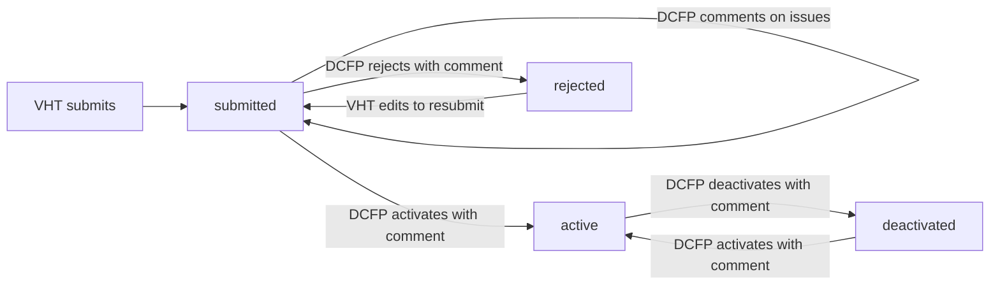

# Hotspots

[Module architecture](README.md)

A village health team member (VHT) submits a hotspot they identified, in the mobile app (VHTs have no web access). The district condom focal person (DCFP, role `dfcp`) is notified, verifies the details and activates the hotspot, comments on any issues, or rejects it with a reason, on the web at `/dcfp/hotspots`. A DCFP can later deactivate and reactivate a hotspot.

## Statuses

A hotspot's `status` is only ever `active` or `inactive`. Its `review_status` records the workflow step behind it:

| `review_status` | `status`   | Meaning                                   |
| --------------- | ---------- | ----------------------------------------- |
| `submitted`     | `inactive` | Awaiting the DCFP's decision              |
| `rejected`      | `inactive` | Rejected; the VHT can edit it to resubmit |
| `active`        | `active`   | In use                                    |
| `deactivated`   | `inactive` | Taken out of use after being active       |

## Endpoints

| Method | Route                              | Permission          | Who                               |
| ------ | ---------------------------------- | ------------------- | --------------------------------- |
| GET    | `/api/v1/hotspots`                 | `hotspots:read`     | VHT, DCFP, national users         |
| POST   | `/api/v1/hotspots`                 | `hotspots:submit`   | VHT                               |
| GET    | `/api/v1/hotspots/notifications`   | `hotspots:read`     | Deprecated; use the central inbox |
| GET    | `/api/v1/hotspots/{id}`            | `hotspots:read`     | VHT, DCFP, national users         |
| PUT    | `/api/v1/hotspots/{id}`            | `hotspots:submit`   | Submitting VHT                    |
| GET    | `/api/v1/hotspots/{id}/events`     | `hotspots:read`     | VHT, DCFP, national users         |
| POST   | `/api/v1/hotspots/{id}/comments`   | `hotspots:read`     | Submitting VHT, DCFP              |
| POST   | `/api/v1/hotspots/{id}/activate`   | `hotspots:activate` | DCFP of the district              |
| POST   | `/api/v1/hotspots/{id}/deactivate` | `hotspots:activate` | DCFP of the district              |
| POST   | `/api/v1/hotspots/{id}/reject`     | `hotspots:activate` | DCFP of the district              |

The submission form gets its region, district and subcounty IDs from the shared [locations](locations.md) endpoints.

Lists return the hotspots directly as `data`, most recently updated first; a comment counts as an update. They accept `limit` (default 50, maximum 100), `offset` and these filters, which only narrow what the caller can already see:

- `status`: `active` or `inactive`
- `review_status`: for example `submitted` for the DCFP's review queue
- `submitted_by_id`: one VHT's hotspots
- `district_id`: one district's hotspots

## Rules

- **Visibility:** a VHT (`hotspots:submit`) sees the hotspots they submitted. With `hotspots:read_district` they also see the **active** hotspots in the district they work in (their assigned store's district, or else their assigned subcounty's), to choose one when requesting stock; this does not let them comment on or edit those hotspots. A DCFP (`hotspots:activate`) sees every hotspot in the district of their assigned store (`users.store_id`). `hotspots:all_districts` sees every hotspot, for national users. Anything else returns HTTP 404.
- **Submission:** these fields are required:
  - name and type
  - `region_id`, `district_id` and `subcounty_id`
  - latitude and longitude
  - contact person name and phone; the contact person is the hotspot manager
  - `has_condom_dispenser`

  `village`, `dispenser_condition` and `comment` are optional. The comment becomes the first in the hotspot's thread. Type and dispenser condition are free text, as in the legacy system. The subcounty must belong to the district and the district to the region.

- **Unique names:** two hotspots in the same village cannot share a name, ignoring case and extra spaces. Hotspots without a village are compared with each other. Legacy hotspots without a subcounty are compared within their district.
- **Editing:** only the submitter can edit, and only while the hotspot is inactive. Editing a rejected hotspot resubmits it. A deactivated hotspot cannot move to another district, so an edit cannot hand a DCFP's decision to another district. A changed contact person is added as a new `contact_persons` row, keeping earlier contacts.
- **Decisions:** activate (from submitted or deactivated), deactivate (from active) and reject (from submitted) each require a comment. The comment is stored with the decision as its `action`. Any other order returns HTTP 409.

## Notifications

Each step is sent through the shared [notification service](notifications.md), so it reaches people in their central inbox (`GET /api/v1/notifications`) with a title, message, read state and a link to the hotspot. The step is also written to `hot_spot_events`, the hotspot's history (`/events`), whose `status` is the review status after the step.

| Type                  | Sent to                                                                  |
| --------------------- | ------------------------------------------------------------------------ |
| `hotspot.submitted`   | DCFPs of the hotspot's district (`hotspots:activate` in that district)   |
| `hotspot.updated`     | The district's DCFPs                                                     |
| `hotspot.resubmitted` | The district's DCFPs                                                     |
| `hotspot.commented`   | The district's DCFPs if the submitter commented, otherwise the submitter |
| `hotspot.activated`   | The submitter, with the DCFP's comment                                   |
| `hotspot.deactivated` | The submitter, with the reason                                           |
| `hotspot.rejected`    | The submitter, with the reason                                           |

District notifications go only to people with `hotspots:activate` in the district, not to everyone assigned to its store. A legacy hotspot without a district has no district recipients. The person who acted is never notified of their own step.

`GET /api/v1/hotspots/notifications`, the earlier hotspot-only inbox, is deprecated. It keeps working until the web and mobile clients use the central inbox, and is then removed.

## Map

The web map (`/moh/hotspot-map`, `/dcfp/hotspot-map`; `frontend/src/features/hotspots/map/`) draws every hotspot the user can see on OpenStreetMap with MapLibre GL. It reads only the endpoints above:

- **Loading.** A user with `hotspots:all_districts` and no district chosen loads `GET /hotspots?district_id=` for each district from `GET /locations/districts`, six requests at a time, and the map fills in as districts arrive. One district's pages come from the `(district_id, updated_at)` index in milliseconds; paging the whole table instead costs a sort of every row for each page, over half a second at the deepest pages with 18,000 hotspots. Hotspots with no district are in no district's list, so the national map cannot show them. A DCFP or VHT has one list, read six pages at a time. A district chosen in the MOH top bar loads that district only.
- **Selection.** `GET /hotspots/{id}` and `GET /hotspots/{id}/events` fill the detail panel.
- **Positions.** A hotspot is drawn only if its recorded position is in Uganda: inside the country's border (Natural Earth 1:10m, simplified to about 1 km, including Uganda's part of the lakes) or within 3 km of it, for border towns. Everything else is left off and listed under **Not on the map** with the position as recorded, so it can be corrected at the source: no position (or (0, 0)), latitude and longitude swapped, or outside Uganda. The export's _Position check_ column says which. The database is not changed. In the dev database 49 positions are outside Uganda: 17 at an Android emulator's default location in California (37.4221, -122.0839), 9 at a web map's corner (85.0511, -180), a few swapped, and the rest in other countries. All 28 hotspots just outside the drawn border were within 2.3 km of it.
- **Uganda in focus.** The map cannot be panned far past the border, everything outside it is dimmed, and the national map opens on the whole country. A map button brings it back.
- **Grouping free text.** Legacy `type` and `dispenser_condition` are free text (types were cut at 8 characters, and "New" or "Old" says nothing about the venue). The map sorts them into venue groups and dispenser states by keyword (`map/records.ts`); the detail panel shows the recorded text.

The base map comes from `NEXT_PUBLIC_MAP_TILES`: empty uses the OpenStreetMap community tiles (Streets and Humanitarian), whose usage policies cover light use with attribution; `off` draws no base map (the end-to-end tests); a `https://…/{z}/{x}/{y}.png` template points at a deployment's own tile server, credited with `NEXT_PUBLIC_MAP_ATTRIBUTION`. A busy production deployment should use its own or a paid tile server.

## Setup

Migrations 8 and 16 grant the hotspot permissions to `admin` only. Grant the other roles through `PUT /api/v1/roles/{id}/permissions`:

- `vht`: `hotspots:read` and `hotspots:submit`
- `dfcp`: `hotspots:read` and `hotspots:activate`
- national roles such as `moh`: `hotspots:read` and `hotspots:all_districts`

Migration 16 fills `regions`, `districts`, `subcounties` and one store per district from `organization_units`. It assigns each legacy DCFP to their district's store. New DCFP accounts need `store_id` set to their district store.

## Legacy data

See [PostgreSQL and legacy imports](../postgresql.md#hotspot-conversion) for how legacy hotspots and earlier submissions are converted, and how to list the hotspots that need cleanup.
